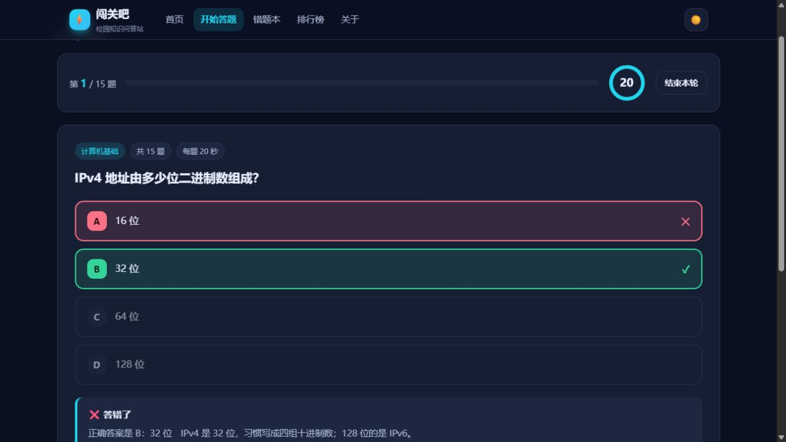
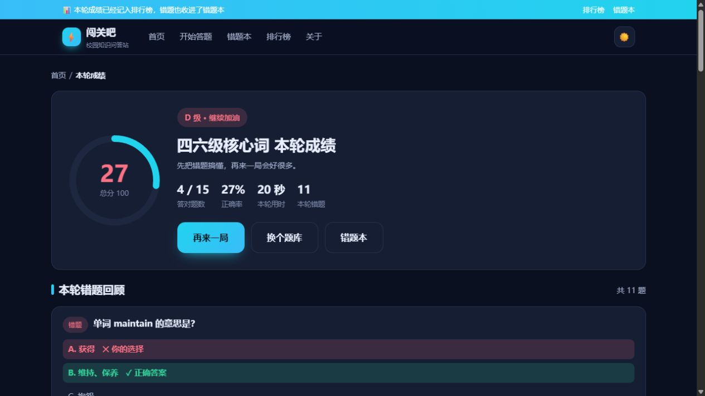
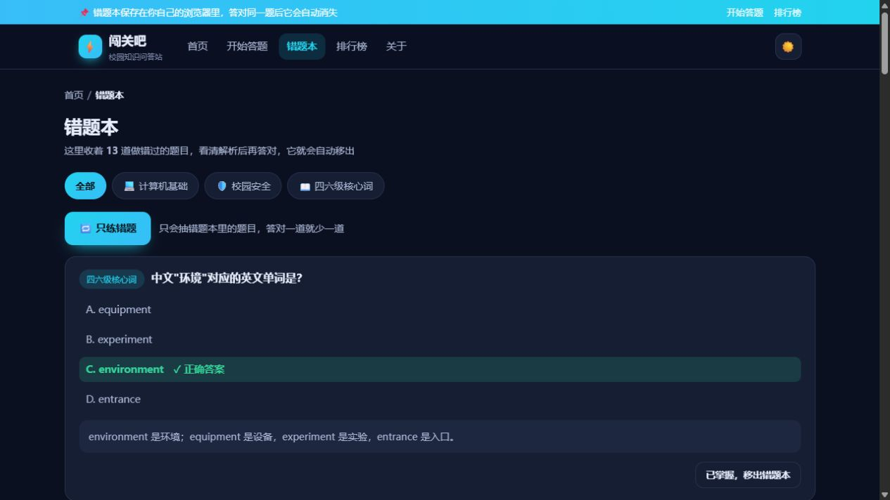
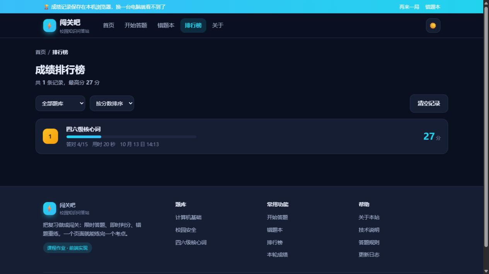

# 闯关吧 · 校园知识问答站

一个纯前端的限时答题闯关网站，共 6 个页面，不需要安装任何环境，双击 `index.html` 就能玩。

> 课程上机作业。题库内容仅用于自测练习，成绩与错题只保存在本机浏览器中。

## 界面预览

| 首页 | 答题页 |
| --- | --- |
|  |  |

| 结果页 | 错题本 |
| --- | --- |
|  |  |

| 排行榜 |  |
| --- | --- |
|  |  |

---

## 一、怎么打开

**方法一（最简单）**：直接双击 `index.html`，用 Chrome / Edge 打开。

**方法二（兼容性最好）**：如果浏览器禁用了本地存储，答题成绩和错题本会失效，这时在项目目录下执行：

```
python -m http.server 8000
```

然后浏览器访问 `http://127.0.0.1:8000/`。

> 本站默认是深色主题，点右上角的 ☀️ / 🌙 可以切换浅色和深色。

---

## 二、目录结构

```
campus-quiz/
├── index.html        首页：站点介绍、三个题库入口、我的成绩统计
├── quiz.html         答题页：限时 20 秒、即时判分、自动进下一题
├── result.html       结果页：得分、评级、用时、错题回顾
├── wrong.html        错题本：错题解析、移出错题本、只练错题
├── rank.html         排行榜：成绩记录、按题库筛选、按分数或用时排序
├── about.html        关于本站：设计目的、答题规则、技术说明
├── css/
│   └── style.css     全站样式（含深浅主题、答题状态、响应式）
├── js/
│   ├── data.js       三个题库共 45 道单选题
│   └── app.js        全部交互逻辑（答题引擎、判分、错题本、排行榜）
├── screenshots/      页面截图，写报告时可以直接用
└── README.md         本文件
```

---

## 三、答题规则

| 规则 | 说明 |
| --- | --- |
| 题目数量 | 每个题库 15 道单选题，一次做完一轮 |
| 答题时间 | 每题限时 20 秒，超时按答错处理并自动进入下一题 |
| 计分方式 | 满分 100 分，按答对比例换算；90 分以上 A 级，75 分以上 B 级，60 分以上 C 级 |
| 题目顺序 | 每轮题目顺序随机打乱，重玩不会一成不变（选项顺序不动） |
| 错题本 | 答错自动加入，答对自动移出，也可以手动标记为已掌握 |
| 快捷操作 | 键盘按 1-4 或 A-D 选答案，回车进下一题 |

---

## 四、页面跳转关系

首页 → 选择题库 → 答题页 → 结果页 → 错题本 → 只练错题 → 再回到答题页，
构成一个可以循环的闭环。此外还有：导航栏六个页面互达、面包屑、页脚三组链接、
结果页的「再来一局」、错题本的「移出错题本」、每页右下角的回到顶部按钮。

答题页和结果页通过网址参数与本地存储传递数据：
`quiz.html?bank=cs` 决定答哪个题库，`quiz.html?bank=wrong` 表示只练错题。

---

## 五、用到的技术

- **HTML5**：语义化标签，六个页面共用同一套页头和页脚。
- **CSS3**：CSS 变量统一管理配色，一套变量驱动深浅两套主题；Grid 与 Flex 布局；
  SVG 圆环进度条（倒计时和成绩环）；正确 / 错误 / 超时三种状态配色；响应式三档断点。
- **原生 JavaScript（ES6）**：
  - **答题状态机**：答题中 / 已作答 / 已结束三个状态，每题只接受一次作答；
  - **倒计时**：定时器每 100 毫秒刷新，换算成圆环的 `stroke-dashoffset`，最后 5 秒变警示色；
  - **判分**：按答对比例换算百分制，按区间给 A 到 D 评级；
  - **题目乱序**：Fisher-Yates 洗牌算法打乱每轮题目顺序；
  - **数据存储**：错题本与成绩记录存在 localStorage，读写都做了异常兜底；
  - **事件委托**：选项点击、错题移除、成绩清空都用事件委托统一处理。

---

## 六、考核点对照

| 考核点 | 本站对应的实现 |
| --- | --- |
| 设计目的 | 用闯关的方式帮同学自测复习，即时判分、错题自动收集、可以只练错题 |
| 跳转 | 导航栏、面包屑、题库卡片、结果页、错题本、再练一局、页脚、回到顶部，形成答题闭环 |
| 交互 | 倒计时、选项判定、即时反馈、自动进下一题、计分评级、错题本增删、成绩排序、深浅色、键盘操作 |
| CSS | 变量与双主题、Grid/Flex、SVG 圆环、状态配色、动效、响应式 |
| 整体效果 | 深色游戏化视觉、题库各自一套渐变色、状态反馈明确、空状态完整 |

---

## 七、想改哪儿，看这里

- **加题**：打开 `js/data.js`，照着现有格式往对应题库的 `questions` 数组里加一条。
  `answer` 是正确选项的下标，0 表示 A。
- **加题库**：在 `js/data.js` 的 `BANKS` 里复制一份结构，改掉 `key`、`name`、`emoji`；
  再去 `css/style.css` 里补一条 `--bank-你的key` 渐变变量和一个 `.bank-你的key .top` 规则。
- **改限时**：改 `js/app.js` 顶部的 `QUESTION_TIME`（单位：秒）。
- **改主题色**：改 `css/style.css` 开头的 `--brand` 和 `--brand-2`，全站一起变。
- **改每轮题数**：在 `js/app.js` 的 `initQuiz` 里给 `round` 加一个 `slice(0, 10)` 即可。

---

## 八、已知限制

- 没有后端，题库写在前端文件里；成绩和错题存在浏览器 localStorage 中，换浏览器或清缓存会丢失。
- 没有账号系统，所以排行榜是本机成绩排行，不是全站排行。
- 答题中途刷新页面会重新开始本轮，成绩不保存。
- 题库内容是我按常见考点整理的，仅用于演示与自测。
